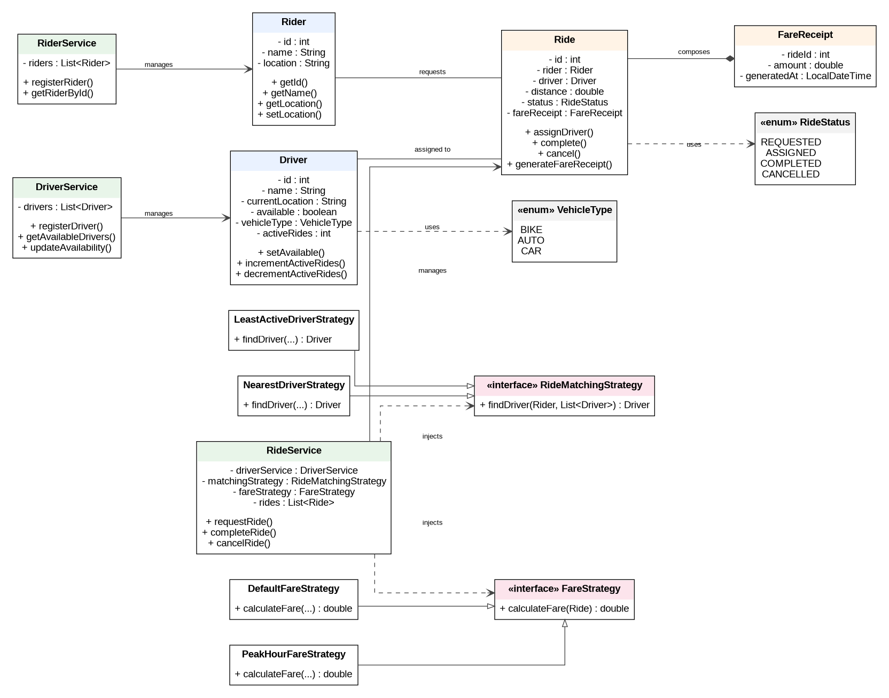

# RideWise — Class Model & Architecture

## 1. Domain Model

### Rider

**Responsibility:** Represents a customer who requests rides.

```text
Rider
-------------------------
- id : int
- name : String
- location : String
-------------------------
+ getId()
+ getName()
+ getLocation()
+ setLocation()
```

### Driver

**Responsibility:** Represents a driver who can accept rides.

```text
Driver
-------------------------
- id : int
- name : String
- currentLocation : String
- available : boolean
- vehicleType : VehicleType
- activeRides : int
-------------------------
+ setAvailable()
+ incrementActiveRides()
+ decrementActiveRides()
```

### Ride

**Responsibility:** Represents a rider's trip and its lifecycle.

```text
Ride
-------------------------
- id : int
- rider : Rider
- driver : Driver
- distance : double
- status : RideStatus
- fareReceipt : FareReceipt
-------------------------
+ assignDriver()
+ complete()
+ cancel()
+ generateFareReceipt()
```

### FareReceipt

**Responsibility:** Stores fare information generated for a ride.

```text
FareReceipt
-------------------------
- rideId : int
- amount : double
- generatedAt : LocalDateTime
```

---

## 2. Service Layer

### RiderService

Responsible for:
- Registering riders
- Looking up riders
- Maintaining rider collection

### DriverService

Responsible for:
- Registering drivers
- Updating driver availability
- Returning available drivers
- Looking up drivers

### RideService

Responsible for:
- Creating rides
- Requesting driver assignment
- Delegating driver matching
- Delegating fare calculation
- Completing rides
- Maintaining ride collection

`RideService` does not implement matching or pricing rules itself.

---

## 3. Strategy Layer

### RideMatchingStrategy

```java
public interface RideMatchingStrategy {
    Driver findDriver(Rider rider, List<Driver> drivers);
}
```

Implementations:

```text
RideMatchingStrategy
        ▲
        │
 ┌──────┴─────────────────┐
 │                        │
NearestDriverStrategy  LeastActiveDriverStrategy
```

### FareStrategy

```java
public interface FareStrategy {
    double calculateFare(Ride ride);
}
```

Implementations:

```text
FareStrategy
     ▲
     │
 ┌───┴────────────────────┐
 │                        │
DefaultFareStrategy   PeakHourFareStrategy
```

---

## 4. Dependency Flow

```text
Main
 │
 ├── RiderService
 ├── DriverService
 │
 └── RideService
       │
       ├── DriverService
       ├── RideMatchingStrategy
       └── FareStrategy
```

The important dependency direction is:

```text
RideService → Strategy Interfaces
                    ▲
                    │
             Concrete Strategies
```

This is dependency inversion through constructor injection.

---

## 5. Why This Model Is Extensible

Suppose a new business rule is required:

```text
Surge pricing during high demand
```

A new class can be added:

```java
public class SurgeFareStrategy implements FareStrategy {
    // surge pricing implementation
}
```

No change is required to `RideService`.

Similarly, a new driver matching algorithm can implement:

```java
RideMatchingStrategy
```

This demonstrates the Open/Closed Principle.


## UML Diagram



The diagram provides a visual view of the domain entities, service layer, and strategy abstractions.
